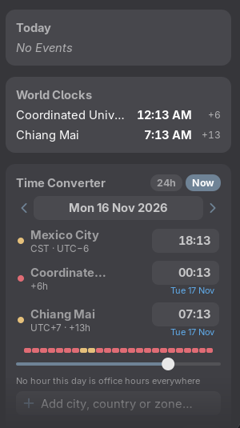
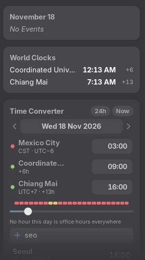

# Time Converter

A GNOME Shell extension: a time zone converter, as a card under **World Clocks** in
the GNOME date menu. Offline: all math is GLib.TimeZone over the system tzdata.

  
  

## Install

GNOME Shell 48–50.

    git clone https://github.com/JuanRamiro08/tz-converter.git
    cd tz-converter
    ./install.sh      # compiles the schema and symlinks into ~/.local/share/gnome-shell/extensions

Log out and back in (Wayland loads extension code at login), then
`gnome-extensions enable tz-converter@juanramiro08.github.io` if it is not
already on. Open the date menu (click the clock).

## Use

- **Pick a day** on the date menu's calendar, with ◀ ▶, or type into the date
  box (`2026-11-20`, `20/11`, `20 nov`, `+3`, `tomorrow`, `mañana`).
- **Set a time** by typing into any city's box (`17`, `17:30`, `5pm`, `noon`)
  and pressing Enter; every other city follows. Or drag the slider (15-min
  steps, reference city's day) or scroll on a row (±15 min).
- **Strip** above the slider: each hour of the reference day, green when it is
  09–18 in every city, yellow when everyone is awake (07–22), red otherwise.
- **Rows**: hover for ⤒ (make reference city) and ✕ (remove). The first row is
  the reference; its date is the calendar's date.
- **Add** by city, country or IANA zone. Not every city is a tzdata zone; a
  short alias list in `tz.js` covers common ones (Guadalajara, Saltillo,
  Houston, Phuket…).
- **Copy** puts the current conversion on the clipboard. **Now** returns to
  live time. **24h/12h** toggles the format.
- Opening the date menu always returns to the current time (the menu itself
  reselects today).

Settings: `org.gnome.shell.extensions.tz-converter` → `cities` (`Zone` or
`Zone|Label`, reference first; empty = seed from local zone + World Clocks),
`hour12`.

## Caveat

The card is added to the date menu by reaching into its private fields
(`_clocksItem`, `_calendar`). A GNOME Shell release that renames them disables
the card (it logs an error instead of crashing); `metadata.json` lists the
versions it has been checked against.

## License

GPL-2.0-or-later. See [LICENSE](LICENSE).

## Dev

    gjs -m tz.test.js        # conversion, DST, parsing, search
    ./install.sh             # symlink into ~/.local/share/gnome-shell/extensions

Wayland caches extension JS per session: log out and in to load changes. The
headless-Shell check printed by `install.sh` confirms it loads (State: ACTIVE).
